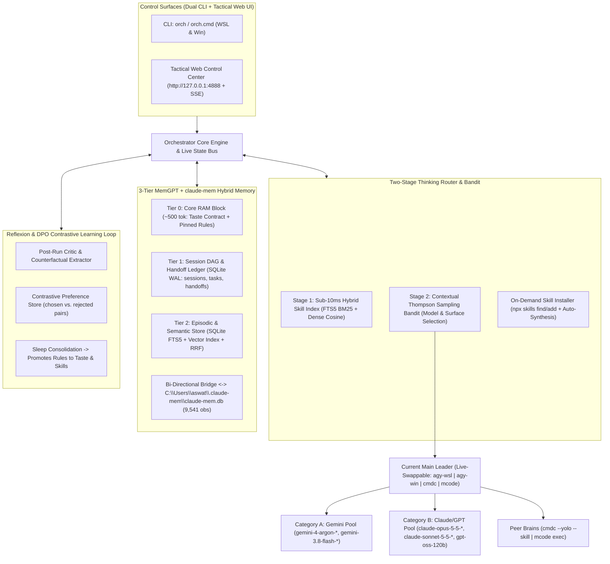

# AGY Multi-Surface & Multi-Model Command Orchestrator Harness (`orch`) — Production Specification (v2: EGM + Ponytail Ultra)

**Date**: 2026-11-10  
**Author**: aswath  
**Location**: `/home/aswath/agy-orchestrator`  
**CLI Entrypoints**: `orch` (WSL) & `orch.cmd` (Windows)  
**Web Control Center**: `http://127.0.0.1:4888` (`orch ui`)  
**Cost Model**: Zero Paid API Keys — 100% powered by authenticated local CLIs (`agy-wsl`, `agy-win`, `cmdc`, `mcode`) + existing local `claude-mem` SQLite/Chroma + local Python/Node runtime.

---

## 1. Executive Critique & `/ponytail [ultra]` Pushback (What We Cut vs. What We Upgraded)

Before writing a single line of product code, an audit of `/home/aswath` and `/mnt/c/Users/aswat` revealed three critical facts that reshape this design:

1. **Why `global-memory.json` Was Dead on Arrival (And What Replaces It)**:
   - A flat JSON memory file grows $O(N)$ with every task, pollutes the prompt with stale context ("Lost in the Middle" phenomenon), cannot rank relevance, and corrupts under concurrent WSL + Windows writes.
   - **Discovery**: You *already* have a 203 MB `claude-mem.db` SQLite database at `/mnt/c/Users/aswat/.claude-mem/claude-mem.db` containing **9,541 observations** and **154 session summaries** with SQLite **FTS5** (`observations_fts`, `session_summaries_fts`), plus `minimax-bridge.mjs` and a worker on `127.0.0.1:37777` — **but `agy` (WSL & Windows) and `cmdc` are not bridged into it.**
   - **Upgrade**: Instead of a naive JSON file, we use a **3-Tier MemGPT + Hybrid Retrieval Architecture** backed by SQLite WAL (`orch-mem.db` with FTS5 BM25 + dense vector embeddings) **and** a live bi-directional bridge to your existing `claude-mem.db`.
2. **Why an LLM-Only Skill Router Is Too Slow (And What Replaces It)**:
   - Feeding 85+ `SKILL.md` descriptions into a CLI subprocess just to pick a skill adds 8–15s of latency and burns quota before work even starts.
   - **Upgrade**: A **Two-Stage Hybrid Router + Contextual Bandit (Thompson Sampling / LinUCB)**:
     - **Stage 1 (<10ms)**: Local BM25 + Character/Word N-Gram SVD Dense Embedding cosine similarity over all 85+ skills in `~/.agents/skills` and `~/.claude/skills` narrows candidates to Top-$K$ ($K=5$).
     - **Stage 2**: Thompson Sampling contextual bandit selects the optimal `(surface, model, category)` pair across **Gemini** and **Claude/GPT** based on historical posterior $(\alpha, \beta)$ reward scores per task cluster, only invoking the CLI router brain when task ambiguity is high or when $\max \text{sim} < \tau$ requires `npx skills` auto-download.
3. **Why `/ponytail [ultra]` Pushes Back on Heavy Frontend Frameworks**:
   - Spinning up a 400 MB Next.js/Vite node_modules tree just to render a local orchestrator control panel violates every rule of `/ponytail [ultra]`.
   - **Upgrade**: A zero-build, hardware-accelerated single-page **Tactical Telemetry Web Control Center** (`src/ui/`) served directly by Node's built-in `node:http` + Server-Sent Events (SSE) on `http://127.0.0.1:4888`, engineered strictly to your `industrial-brutalist-ui` (Archetype 2.2: Tactical Telemetry & CRT Terminal) + `design-taste-frontend` specifications.

---

## 2. System Architecture



---

## 3. Deep Technical Design by Subsystem

### 3.1 Memory Engine: 3-Tier MemGPT + `claude-mem` Bridge + Reciprocal Rank Fusion (`src/memory/`)

Simple JSON cannot handle semantic lookup, concurrent writes, or token budgets. Our memory engine uses Python's built-in `sqlite3` (v3.45.1 with **FTS5** enabled) + `numpy` (v2.5.2, already installed) via a fast persistent stdio/HTTP worker, coupled with your existing `claude-mem.db`:

1. **Tier 0 — Core Pinned Memory (`core_blocks` table)**:
   - Strict token cap (600 tokens). Contains the compiled `[USER TASTE CONTRACT]`, active workspace invariants, and hard rules (like git authorship and no-truncation). Always injected into system context.
2. **Tier 1 — Session Context & Task DAG (`sessions`, `task_nodes`, `handoffs` tables)**:
   - Tracks per-session conversation state, structured `handoff` blocks (`State | Next | Files | Open`, compatible with your `HarnessAgents/hive/PROTOCOL.md`), and native CLI session IDs (`--conversation` for `agy`, `--session` for `cmdc`/`mcode`) so follow-up turns resume warm context instead of paying cold-start penalties.
3. **Tier 2 — Archival Hybrid Store (`memories`, `memories_fts`, `memory_vectors` + `claude-mem.db` bridge)**:
   - Every observation, decision, and artifact is indexed in:
     - **SQLite FTS5** (`tokenize='porter unicode61'`) for exact symbol/path/keyword BM25 retrieval.
     - **Dense Vector Embeddings**: 384-dimensional L2-normalized float32 vectors (computed locally via Ollama if running, or deterministic Character/Word N-gram Random Projection / TF-IDF SVD in `numpy` in <3ms with zero network/API cost).
   - **Live `claude-mem` Sync**:
     - Reads directly from `/mnt/c/Users/aswat/.claude-mem/claude-mem.db?immutable=1` (`observations_fts` + `session_summaries_fts`, giving instant access to your 9,541 historical observations).
     - Watches WSL `~/.gemini/antigravity-cli/brain/*/transcript.jsonl` and Windows `C:\Users\aswat\.gemini\antigravity-cli\brain\*\transcript.jsonl` and forwards summaries into `claude-mem` (`http://127.0.0.1:37777/api/sessions/summarize`) just like your `minimax-bridge.mjs`.
4. **Mathematical Retrieval Model (Hybrid RRF + Ebbinghaus Decay)**:
   When assembling context for a task query $q$, candidate memories $d$ are scored via **Reciprocal Rank Fusion (RRF)** modulated by temporal recency $\Delta t$ (hours since last access) and salience $s_d$:
   $$\text{RRF}(d, q) = \left( \frac{0.45}{60 + \text{rank}_{\text{BM25}}(d, q)} + \frac{0.55}{60 + \text{rank}_{\text{cos}}(d, q)} \right) \cdot \exp(-\lambda \Delta t) \cdot \left(1 + 0.15 \ln(1 + \text{access\_count}_d)\right) \cdot s_d$$
   Only the top-$M$ memories fitting within a strict token budget (default `1,500` tokens) are injected, eliminating context bloat.

---

### 3.2 Thinking Skill Router & Multi-Armed Bandit Model Selector (`src/router/`)

Instead of static rules or slow LLM-only routing, routing happens in three deterministic + probabilistic stages:

1. **Task Feature Extraction**:
   - Classifies task intent vector across 8 dimensions: `[architecture, implementation, debugging, frontend_ui, windows_os, wsl_linux, research, refactor]`.
2. **Sub-10ms Hybrid Skill Retrieval**:
   - Indexes all skills across `/home/aswath/.agents/skills`, `/home/aswath/.claude/skills`, and `/mnt/c/Users/aswat/.claude/skills` (frontmatter `name`, `description`, trigger phrases, and body headings) into SQLite FTS5 + dense vectors.
   - Computes RRF similarity between the task prompt and all indexed skills.
   - **Dynamic Skill Acquisition Gate**:
     - If $\max_s \text{sim}(q, s) < \tau_{\text{install}}$ (or the user/leader requests a missing domain capability), the router automatically executes `npx --yes skills find <keyword>` and `npx --yes skills add <repo>` into `/home/aswath/.agents/skills/`, re-indexes on the fly, and mounts the `SKILL.md`.
3. **Thompson Sampling Contextual Bandit for Leader/Subagent Selection**:
   - Every `(agent_id, surface, model, category, task_dimension)` tuple maintains a Beta posterior $\text{Beta}(\alpha, \beta)$ updated after every run:
     - $\alpha \leftarrow \alpha + r$ (where $r \in [0, 1]$ is the composite reward from exit status, latency efficiency, and taste score)
     - $\beta \leftarrow \beta + (1 - r)$
   - When dispatching subagents, the router samples $\theta_i \sim \text{Beta}(\alpha_i, \beta_i)$ and enforces the **Dual-Category Constraint**:
     - At least one **Category A (Gemini)** model (`gemini-4-argon-*` or `gemini-3.8-flash-*`) and one **Category B (Claude/GPT)** model (`claude-opus-5-5-*`, `claude-sonnet-5-5-*`, or `gpt-oss-120b-medium`) participate in multi-step plans (e.g., Elephant drafter + Goldfish reviewer, or Planner + Implementer).

---

### 3.3 Continuous Learning Loop & User Taste Engine (`src/learning/` & `src/taste/`)

1. **User Taste Model (`taste/taste-profile.json` + SQLite `taste_rules`)**:
   - Stores explicit weighted preferences across 4 axes:
     - **Coding Style**: `ponytail:ultra` (minimal diff, zero dead abstractions, standard library first, no truncation/placeholders).
     - **UI/UX Aesthetic**: `industrial-brutalist-ui` + `design-taste-frontend` (no generic Inter/purple slop, razor-sharp 1px grids, high-contrast telemetry, spring micro-physics).
     - **Workflow & Git**: Explicit `GIT_AUTHOR_NAME` / `GIT_COMMITTER_NAME` preservation (learned from your `HarnessAgents` history), artifact-first specs (`egm`).
     - **Communication**: Direct, plain English, zero sycophancy/glazing, critique first (`egm` rules).
   - Syncs bi-directionally with `cmdc` (Command Code) taste rules.
2. **Reflexion + Contrastive Preference Learning Loop**:
   - After every task execution (or when you click **Approve / Reject / Correct** in the Web UI or run `orch learn "<feedback>"`):
     1. **Bandit Posterior Update**: Immediately updates $(\alpha, \beta)$ for the Leader, Subagents, and Skills used.
     2. **Contrastive Tuple Extraction (DPO-style)**: If a step failed, was retried, or was corrected by you, stores a structured contrastive pair:
        ```json
        {
          "task_cluster": "wsl-sqlite-bridge",
          "rejected": "sqlite3.connect('/mnt/c/.../claude-mem.db') without immutable=1",
          "chosen": "sqlite3.connect('file:/mnt/c/.../claude-mem.db?immutable=1', uri=True)",
          "root_cause": "9p filesystem in WSL2 fails fcntl lock on WAL -shm files",
          "confidence": 0.95
        }
        ```
     3. **Sleep Consolidation (`orch consolidate` or auto every 10 runs)**: Compresses recurring contrastive pairs into permanent `Tier 0` Taste/Memory rules or auto-generates a new local skill under `~/.agents/skills/learned-<slug>/SKILL.md`.

---

### 3.4 Rich Web Control Center & Self-Improviser (`src/ui/` — `orch ui`)

While the harness runs 100% headlessly from the CLI (`orch run`, `orch ask`, `orch set-leader`), running `orch ui` starts a lightweight local server on `http://127.0.0.1:4888` with a live **Server-Sent Events (SSE)** stream and REST control API.

#### Visual Design System (`industrial-brutalist-ui` Archetype 2.2 + `design-taste-frontend`)
- **Substrate Palette**: Deactivated CRT Carbon (`#0A0A0A` background, `#121212` elevated cells), White Phosphor (`#EAEAEA`) primary typography, Muted Ash (`#7A7A7A`) secondary labels, Aviation Hazard Red (`#E61919`) primary structural/active accent, and a single Terminal Green (`#4AF626`) live heartbeat readout.
- **Typography**: `Archivo Black` / `Geist` uppercase macro headers (`tracking: -0.04em`, tight leading) paired with `JetBrains Mono` (`12px`, `tracking: 0.06em`) for all model IDs, latencies, bandit $\alpha/\beta$ scores, and live stdout streams.
- **Spatial Architecture**: `display: grid; gap: 1px;` blueprint compartments with `0px` border-radius, crosshair (`+`) intersections, and tactile `scale-[0.98]` active states.

#### Interactive Capabilities in the Web UI
1. **Live Topology & Leader Switchboard**:
   - One-click **Promote to Main Leader** on any agent card (`agy-wsl`, `agy-win`, `cmdc`, `mcode`).
   - Live dropdowns to switch models across **Category A (Gemini)** and **Category B (Claude/GPT)**, adjust reasoning effort (`low | medium | high | xhigh | max`), toggle `agy` CLI themes (`tokyo night`, `solarized dark`, etc. across WSL & Windows), and add/remove subagent workers on the fly.
2. **Live Task Execution & EGM Goldfish Review Board**:
   - Dispatch tasks directly from the web command bar in 3 modes:
     - **Standard Orchestration** (Leader decomposes -> Subagents execute in parallel/sequence -> Synthesize)
     - **EGM Elephant + Goldfish Mode** (Elephant drafts with full memory -> Fresh Goldfish subagent from the *opposite* model category critiques with zero conversation bias -> Leader resolves)
     - **Direct Single-Brain Dispatch**
   - Watch real-time node status (`IDLE`, `ROUTING`, `PLANNING`, `EXECUTING`, `CRITIQUING`, `DONE`), live streaming output, elapsed time, and active skills per agent.
3. **Hybrid Memory (`claude-mem` + `orch-mem`) & Skill Router Inspector**:
   - Live search bar querying both your 9,541 `claude-mem.db` observations and `orch-mem.db` using Hybrid RRF (shows exact BM25 rank, Vector cosine score, and final RRF score).
   - Browse all 85+ local skills, test-route any prompt to preview which skills and models the Bandit picks, or install new skills from `npx skills` with one click.
4. **Taste Tuner & "Improvise / Self-Evolve Harness" Studio**:
   - Edit your Taste Profile sliders (`DESIGN_VARIANCE`, `MOTION_INTENSITY`, `VISUAL_DENSITY`, `PONYTAIL_LEVEL`) and rules live.
   - **Self-Improvise Box**: Type a new feature request for the orchestrator itself (e.g., *"Add a Telegram webhook notifier when a long task finishes"* or *"Add a new chart for Bandit reward history"*), and the harness dispatches an agent scoped to `/home/aswath/agy-orchestrator` to modify its own code and hot-reload!

---

### 3.5 Phone & Remote Chat Automation Agent (`src/automation/phone-bridge.mjs`)

To allow you to message the orchestrator from your phone at any time (via Google Keep/Notes forwarding, chat apps, or push topics) and have it autonomously execute work and report back to your phone:

1. **Channel 1 — Zero-Config `ntfy.sh` Bi-Directional Pub/Sub Topic (`ntfy`)**:
   - Subscribes via HTTP stream to a private topic `https://ntfy.sh/<your-secret-topic>/json`.
   - From your phone: install the free `ntfy` app (Android/iOS) or use Google Keep / iOS Shortcuts / Android Share Sheet to send any note or text to `https://ntfy.sh/<your-secret-topic>`.
   - The Automation Agent picks up the message in real time, runs the full `orch` pipeline (Router -> Leader -> Subagents), and publishes progress + final summary back to `https://ntfy.sh/<your-secret-topic>-out` so your phone receives an instant push notification with the result.
2. **Channel 2 — Cloud-Synced Notes Inbox Watcher (Google Keep Export / OneDrive / Markdown Dropfile)**:
   - Watches `/mnt/c/Users/aswat/OneDrive/Orch-Phone-Inbox.md` (already synced to your Windows OneDrive) plus any custom path (e.g. Google Drive / Obsidian / Keep synced folder).
   - Whenever you add an unchecked task line `- [ ] <instruction>` from your phone's notes app, the daemon detects the file change, marks it `- [~] <instruction> (running...)`, executes the task via the orchestrator, updates it to `- [x] <instruction>`, and appends the timestamped result block right inside the same note so you can read it on your phone.
3. **Channel 3 — Telegram Bot Long-Polling Forwarder (`telegram`)**:
   - Optional zero-webhook long-polling bridge (`getUpdates` / `sendMessage`). Forward any message, note, or voice-transcript to your bot from your phone; it authenticates against your `allowedChatIds`, executes via `orch`, and replies in thread.
4. **Channel 4 — Mobile Command Chat & `agy remote-control` Integration**:
   - The Web Control Center (`http://0.0.0.0:4888`) includes a dedicated **PHONE / REMOTE AUTOMATION** tab where you can configure your `ntfy` topic, OneDrive/Google Notes watch path, Telegram token, or toggle `agy remote-control start|stop`, plus use a mobile-optimized chat drawer from your phone browser over Wi-Fi/Tailscale.

---

## 4. EGM Goldfish Stress-Test Summary (Pre-Implementation Risks & Mitigations)

| Lens | Risk Identified | Mitigation Engineered into v2 Spec |
| :--- | :--- | :--- |
| **Contrarian / YAGNI (`/ponytail ultra`)** | Don't build a React/Webpack build pipeline or duplicate `claude-mem`. | UI uses zero-build ES modules + CSS Grid served by `node:http`. Memory reads `claude-mem.db` directly (`?immutable=1`) and adds a lightweight SQLite FTS5 + `numpy` vector index (`orch-mem.db`) for cross-OS writes. |
| **WSL ↔ Windows Boundary** | `cmd.exe` fails on UNC paths (`\\wsl.localhost\...`) and SQLite WAL locks fail over 9p (`/mnt/c/`). | `orch-mem.db` lives on native Linux ext4 (`/home/aswath/agy-orchestrator/memory/orch-mem.db`) for lock-free WAL speed; Windows `agy.exe` & `cmdc.cmd` run with `cwd: C:\Users\aswat` and exchange payloads via `/mnt/c/Users/aswat/.agy-orch-bridge`. |
| **Latency & Quota Economics** | Spawning 5 CLI subagents for a trivial question wastes 45 seconds and session quota. | Router computes a **Complexity Gate**: simple tasks run single-hop on the Leader or fast worker (`--single`), while complex tasks trigger full Leader + dual-category Subagent fan-out. |
| **Observability** | Headless CLI subprocesses (`agy -p`, `mcode exec`) look frozen if stdout is buffered until exit. | Adapters use `spawn` with streaming `stdout`/`stderr` line buffers emitted over the internal EventBus to both the terminal and Web UI SSE stream in real time. |
